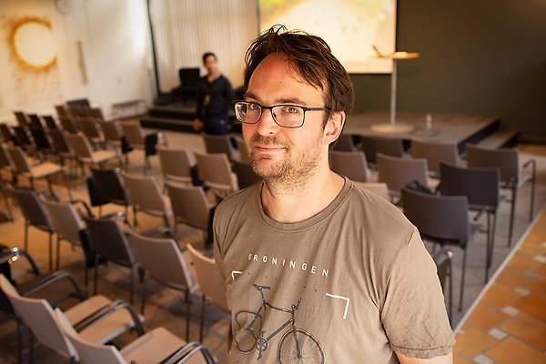

# Frequently asked questions

## Who is my supervisor?

Richèl.

???- "How does he look like?"

    Here is how he loooks like
    
    

???- "How to pronounce his name??"

    Language |Pronunciation
    ---------|-------------
    English  |'Rea-shell', rhymes on 'sea shell'
    Swedish  |'Ri-kjell', `rikedom och kjell och company`

## What should I bring?

- a laptop with an adapter
- (optional) food

## Where in Uppsala is this?

At the Biomedical Center, Husargatan.
See [location](location.md) how to get there.

## Where in the Biomedical Center must I be?

At [office D5:514c](https://link.mazemap.com/1o82OwUi).
See [office](office.md) how to get there

## Are there microwaves to heat my lunch food?

Yes.

## What happens when I am early?

- You will make a great first impression
- It will be noted in the
  [reflection from the supervisor](reflection_from_supervisor.md)
- The PRAO will end earlier:
  that is one of the features of working at NBIS: we ourselves can determine
  when we work.

## What happens when I am late?

- You will make a bad first impression
- It will be noted in the
  [reflection from the supervisor](reflection_from_supervisor.md)
- The PRAO will end later:
  that is one of the features of working at NBIS: we ourselves can determine
  when we work.
